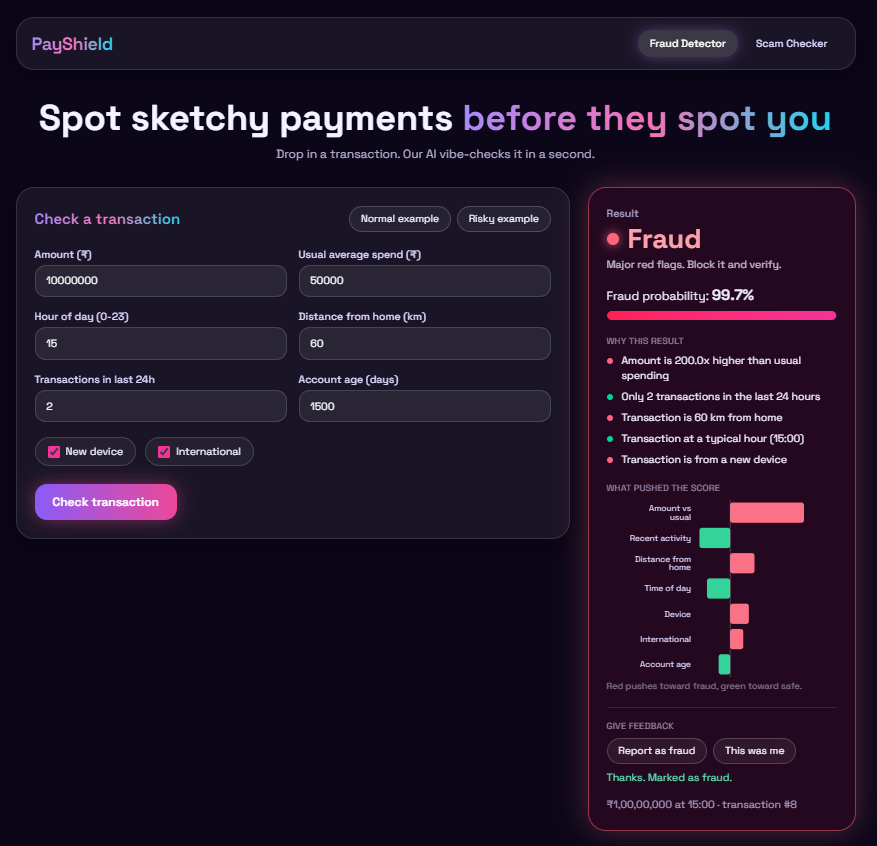
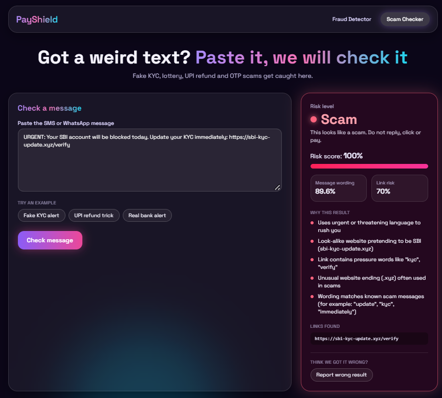
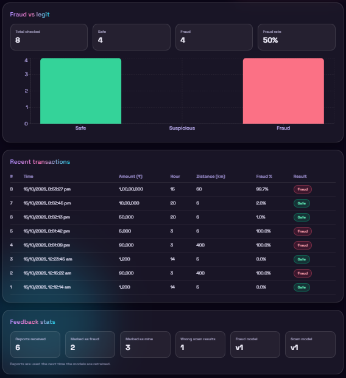
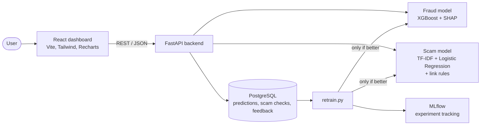

# PayShield


**AI-powered payment fraud detection with plain-English explanations, a scam message checker, and a feedback loop that lets the models learn from user corrections.**

PayShield takes a payment transaction, predicts whether it is fraudulent, explains why, and shows the result in a dashboard. It also checks suspicious SMS and WhatsApp messages and links for common Indian scams (fake KYC, lottery, UPI refund and OTP messages).

> **Live demo:** coming soon (added after deployment)

## Screenshots

**Fraud detection with explanations**



**Scam message checker**



**Feedback stats**



## Features

- **Fraud prediction:** an XGBoost model returns a fraud probability and a label (Safe, Suspicious or Fraud).
- **Explainable alerts:** SHAP shows which factors pushed the score up or down, written as plain English plus a contribution chart.
- **Scam checker:** paste an SMS or WhatsApp message and get a risk score, a label (Safe, Suspicious or Scam) and reasons.
- **Feedback loop:** users can report wrong results, and a retraining script only replaces a model if the new one scores better.
- **Dashboard:** transaction form, history table and charts built with React, Tailwind CSS and Recharts.
- **One-command setup:** Docker Compose runs the database, backend and frontend together.

## Architecture



## Tech stack

| Area | Tools |
|---|---|
| Backend | Python, FastAPI, SQLAlchemy, Pydantic |
| Fraud model | XGBoost, scikit-learn, SHAP |
| Scam checker | TF-IDF + Logistic Regression, rule-based URL checks |
| Experiment tracking | MLflow |
| Frontend | React (Vite), Tailwind CSS, Recharts |
| Database | PostgreSQL |
| DevOps | Docker, Docker Compose, GitHub Actions |
| Testing | pytest |

## Quick start (Docker)

You need [Docker Desktop](https://www.docker.com/products/docker-desktop) running.

```bash
git clone https://github.com/AnushkaSingh716/payshield.git
cd payshield
docker compose up --build
```

The first build takes a few minutes. Then open:

- Dashboard: http://localhost:3000
- API docs: http://localhost:8000/docs

Stop with `Ctrl+C`, then `docker compose down` (your data is kept). Use `docker compose down -v` to also wipe the database.

The trained models are included in `ml/artifacts/`, so nothing needs to be trained to run the app.

If Docker says `ports are not available` for port 5432 (common on Windows), see Troubleshooting below.

## Run without Docker (development)

Prerequisites: Python 3.10 to 3.12, Node.js 20 or newer, Docker (for the database), Git.

```bash
# 1. Python environment
python -m venv .venv
# Windows: .venv\Scripts\Activate.ps1      Mac/Linux: source .venv/bin/activate
pip install -r ml/requirements.txt -r backend/requirements.txt

# 2. Settings
cp .env.example .env          # Windows PowerShell: Copy-Item .env.example .env

# 3. Database only
docker compose up db -d

# 4. Backend (http://localhost:8000)
cd backend
uvicorn app.main:app --reload

# 5. Frontend, in a second terminal (http://localhost:5173)
cd frontend
cp .env.example .env          # Windows PowerShell: Copy-Item .env.example .env
npm install
npm run dev
```

If you change `DB_PORT` in `.env`, use the same port in `DATABASE_URL`.

## How it works

### Explainable fraud alerts

`POST /predict` scores a transaction and also returns the top reasons in plain English, for example "Amount is 60.0x higher than usual spending" or "Transaction at an unusual hour (03:00)". SHAP values for the raw columns are grouped into seven factors: amount vs usual, time of day, distance from home, recent activity, device, international and account age. The dashboard shows the reasons and a bar chart of each factor's contribution (red pushes toward fraud, green toward safe).

### Scam message and link checker

`POST /check-message` combines two checks:

1. **Text model:** TF-IDF and Logistic Regression trained on labeled scam and safe messages.
2. **Link rules:** raw IP addresses, shortened links, missing HTTPS, look-alike bank domains, pressure words in the link, unusual website endings and very long links.

The final risk score is the wording score plus half of the link risk (capped at 100). Below 35 is Safe, 35 to 65 is Suspicious, and 65 or more is Scam. Plain-English reasons explain the result.

### Feedback loop

- On a transaction result, **Report as fraud** saves the label "fraud" and **This was me** saves "legit".
- On a scam check, **Report wrong result** saves the opposite of what the model said.
- `POST /feedback` stores the label in a PostgreSQL `feedback` table linked to the prediction. Sending feedback again for the same item replaces the earlier answer.
- `ml/retrain.py` trains new models on the original data plus the feedback, evaluates the current and new models on the same held-out test set, and only replaces a model if it scores better (F1, then ROC-AUC). The old model is backed up, the version number goes up, and every run is logged in MLflow.

```bash
python ml/retrain.py                    # both models, needs 5 or more feedback rows each
python ml/retrain.py --min-feedback 1   # easier for demos
python ml/retrain.py --model fraud      # one model only
```

After a model is replaced, restart the backend (or run `docker compose up --build` for Docker) so it loads the new model.

## API

Interactive docs: http://localhost:8000/docs

| Method | Endpoint | Description |
|---|---|---|
| GET | `/health` | Health check; shows whether both model files were found |
| POST | `/predict` | Score a transaction and explain the result |
| GET | `/transactions?limit=20` | Prediction history, newest first |
| GET | `/stats` | Counts for the dashboard charts |
| POST | `/check-message` | Check a message and its links for scam signs |
| POST | `/feedback` | Save a user correction |
| GET | `/feedback/stats` | Number of reports and model versions in use |

**Example: `POST /predict`**

```json
{
  "amount": 90000,
  "avg_amount_30d": 1500,
  "hour": 3,
  "distance_from_home_km": 400,
  "txn_count_24h": 9,
  "is_new_device": true,
  "is_international": true,
  "account_age_days": 20
}
```

Response (shortened):

```json
{
  "id": 1,
  "label": "Fraud",
  "fraud_probability": 0.99,
  "reasons": [
    { "text": "Amount is 60.0x higher than usual spending", "direction": "increases" },
    { "text": "Transaction is 400 km from home", "direction": "increases" }
  ],
  "contributions": [
    { "feature": "Amount vs usual", "impact": 3.2 }
  ]
}
```

**Example: `POST /check-message`**

```json
{ "text": "URGENT: Your SBI account will be blocked today. Update your KYC immediately: https://sbi-kyc-update.xyz/verify" }
```

Response (shortened):

```json
{
  "id": 1,
  "label": "Scam",
  "risk_score": 100.0,
  "reasons": [
    { "text": "Look-alike website pretending to be SBI (sbi-kyc-update.xyz)", "direction": "increases" }
  ],
  "urls_found": ["https://sbi-kyc-update.xyz/verify"]
}
```

**Example: `POST /feedback`**

```json
{ "kind": "transaction", "target_id": 1, "action": "report_fraud" }
```

Valid actions: `report_fraud` and `this_was_me` for `kind: "transaction"`, and `report_wrong` for `kind: "message"`.

## Data and models

Datasets are not stored in Git. Both are generated by scripts (the models in `ml/artifacts/` are already trained):

```bash
python ml/make_synthetic_data.py   # synthetic transactions (about 2% fraud)
python ml/explore_data.py          # quick look and class imbalance
python ml/make_scam_dataset.py     # Indian-style scam and safe messages
python ml/train_fraud.py           # trains the fraud model, logs to MLflow
python ml/train_scam.py            # trains the scam text model, logs to MLflow
mlflow ui --backend-store-uri sqlite:///mlflow.db   # view runs at http://localhost:5000
```

- Class imbalance is handled with class weights (`scale_pos_weight`).
- Models are evaluated with precision, recall, F1 and ROC-AUC, not just accuracy.

## Project structure

```
payshield/
├── backend/
│   ├── app/
│   │   ├── main.py, config.py, database.py, models.py, schemas.py
│   │   ├── routers/    health, predict, transactions, stats, scam, feedback
│   │   └── services/   fraud_model, explain (SHAP), scam_text_model, url_checks, scam_checker
│   ├── tests/
│   └── Dockerfile
├── ml/
│   ├── make_synthetic_data.py, explore_data.py, make_scam_dataset.py
│   ├── train_fraud.py, train_scam.py, retrain.py
│   └── artifacts/      model.pkl, scam_model.pkl, version files
├── frontend/
│   ├── src/            pages, components, api.js
│   └── Dockerfile
├── docs/screenshots/
├── .github/workflows/tests.yml
└── docker-compose.yml
```

## Testing

```bash
cd backend
pytest
```

The backend has 24 tests covering health, prediction, explanations, the scam checker, link checks and feedback. GitHub Actions runs them, and builds the frontend, on every push.

## Troubleshooting

| Problem | Fix |
|---|---|
| `ports are not available ... forbidden by its access permissions` (Windows) | Windows has reserved port 5432. Add `DB_PORT=5433` to `.env` (and change the port in `DATABASE_URL` to 5433), then run `docker compose down` and `docker compose up --build` |
| `No module named 'psycopg'` | Run `pip install "psycopg[binary]"` with the virtual environment active |
| PowerShell says "running scripts is disabled" | Run `Set-ExecutionPolicy -Scope CurrentUser RemoteSigned`, then activate the environment again |
| "port is already allocated" (5432 or 8000) | Something else is using the port. Stop the old container (`docker stop payshield-db`) or the running `uvicorn` |
| Page says "site can't be reached" | The containers are not running. Run `docker compose ps`, then `docker compose up` |
| Dashboard shows "Cannot reach the API" | Start the backend, or run `docker compose logs backend` to see why it stopped |
| CORS error in the browser console | Open the app at exactly `http://localhost:3000` (Docker) or `http://localhost:5173` (dev), not `127.0.0.1` |
| `relation "feedback" does not exist` | Restart the backend so it creates the new tables |
| `retrain.py` says it could not reach the database | Start the database with `docker compose up db -d` |
| "Cannot connect to the Docker daemon" | Open Docker Desktop and wait until it says it is running |

## Limitations

- The fraud and scam datasets are synthetic, so scores look better than they would on real-world data.
- Feedback labels are trusted as-is. A real system would review reports before training on them.
- Models are baked into the Docker image, so rebuild after retraining.
- There is no user login. This is a portfolio project, not a production system.